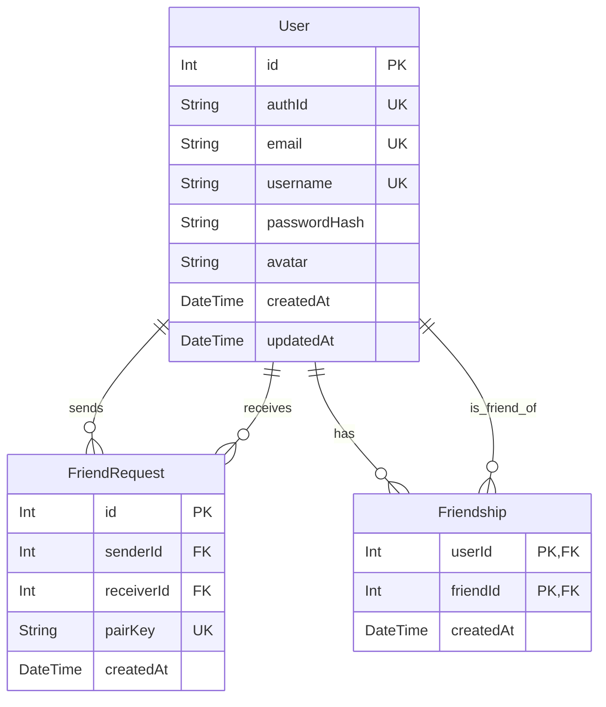

*This project has been created as part of the 42 curriculum by doley, yel-mens, amairia, alexfuen.*

# ft_transcendence — ft_chess

## Description

**ft_chess** is a full-stack multiplayer chess web application developed for the 42 `ft_transcendence` project.

Users can create an account, manage their profile and friends, chat in real time, play chess remotely against another user, or play against a Stockfish AI opponent.

The application is designed as a complete client/server system with secure authentication, real-time communication, persistent user data and containerized deployment.

### Key features

- Secure registration and login
- User profiles and avatars
- Friends system with online presence
- Real-time private chat between friends
- Complete chess game with legal move validation
- Remote two-player games
- Game reconnection and disconnection handling
- Draw offers and resignation
- Stockfish AI with multiple difficulty levels
- Responsive interface
- Privacy Policy and Terms of Service
- HTTPS and secure WebSocket communication

---

## Team Information

| Member | 42 login | Role | Main responsibilities |
| --- | --- | --- | --- |
| Dorian | `doley` | Product Owner, Tech Lead, Developer | Backend architecture, database, authentication, backend Socket.IO integration, social features, Docker, Caddy and project integration |
| Yacine | `yel-mens` | Project Manager / Scrum Master, Developer | Main frontend development and frontend integration of authentication, profiles, friends, chat, sockets and multiplayer features |
| Ayoube | `amairia` | Developer | Chess engine, chess rules and calculations with chess.js, game logic and Stockfish AI |
| Alexandre | `alexfuen` | Developer / UI & Visual Designer | Artistic direction, CSS, visual identity, chess interface design, pieces and overall UI consistency |

---

## Project Management

Work was divided according to each member's main area of responsibility, while features requiring both frontend and backend work were integrated collaboratively.

Development followed a Git-based workflow:

```text
feature / fix / chore branches
            │
            ▼
       Pull Requests
            │
            ▼
           dev
            │
            ▼
          main
```

`dev` was used as the integration branch, while dedicated branches were used for individual features and fixes.

Code was reviewed and integrated through **GitHub Pull Requests**.

Team communication was handled through a **Discord group and voice calls**, which were used to coordinate tasks, discuss technical decisions and perform multiplayer testing together.

---

## Technical Stack

### Frontend

- **React** — component-based frontend framework
- **TypeScript** — static typing for frontend code
- **Vite** — frontend development and build tooling
- **Tailwind CSS / CSS** — responsive styling and visual design

React was chosen to structure the application around reusable components and stateful interfaces, while TypeScript helps catch frontend errors earlier.

### Backend

- **Node.js**
- **Express**
- **JavaScript ESM**
- **Socket.IO**
- **JWT**
- **Argon2**
- **chess.js**
- **Stockfish**

Express was chosen as a lightweight backend framework that integrates naturally with Node.js, while Socket.IO provides the bidirectional real-time communication required for multiplayer games, presence and chat.

`chess.js` is used by the chess engine to implement and validate chess rules and game state.

Stockfish provides the AI opponent.

### Database

- **PostgreSQL**
- **Prisma ORM**

PostgreSQL was chosen as a reliable relational database for persistent account and social data.

Prisma provides an explicit database schema, migrations and simplified database access.

### Infrastructure

- **Docker**
- **Docker Compose**
- **Caddy**
- **Makefile**

Docker Compose provides a reproducible single-command deployment, while Caddy centralizes HTTPS termination and reverse-proxy routing for the frontend, API and Socket.IO connections.

---

## Architecture

```text
                         HTTPS / WSS
                             │
                             ▼
                    ┌─────────────────┐
                    │      Caddy      │
                    │ Reverse Proxy   │
                    └────────┬────────┘
                             │
                 ┌───────────┴───────────┐
                 │                       │
                 ▼                       ▼
        ┌─────────────────┐     ┌─────────────────┐
        │    Frontend     │     │     Backend     │
        │ React + Vite    │     │ Express +       │
        │                 │     │ Socket.IO       │
        └─────────────────┘     └────────┬────────┘
                                        │
                                      Prisma
                                        │
                                        ▼
                               ┌─────────────────┐
                               │   PostgreSQL    │
                               └─────────────────┘
```

The Docker environment contains four services:

- `frontend`
- `backend`
- `db`
- `caddy`

---

## Database Schema

Persistent data is limited to accounts, profiles and social relationships.

Chess games and chat messages are handled in memory and are not stored as match history.

### Relationships



### Main models

#### `User`

Stores:

- unique internal ID
- public authentication UUID
- email
- username
- Argon2 password hash
- optional avatar
- creation and update timestamps

#### `FriendRequest`

Represents a pending friendship request between two users.

A unique `pairKey` prevents duplicate requests for the same pair.

#### `Friendship`

Represents an established relationship between two users using a composite primary key.

Foreign-key relations use cascading deletion where appropriate.

---

## Features

| Feature | Description | Main contributors |
| --- | --- | --- |
| Authentication | Registration, login, JWT sessions and Argon2 password hashing | Dorian, Yacine |
| User profiles | Profile data, avatar handling and frontend integration | Dorian, Yacine |
| Friends | Requests, accept/remove actions and friend lists | Dorian, Yacine |
| Online presence | Real-time friend online/offline status | Dorian, Yacine |
| Chat | Real-time messaging between friends | Dorian, Yacine |
| Chess engine | Chess rules, move calculations, game state and legal move validation with chess.js | Ayoube |
| Chess backend integration | Socket events, server integration and supporting game service functions | Dorian |
| Remote games | Two authenticated users can play from separate computers | Dorian, Yacine |
| Reconnection | Players can reconnect to an active game after a temporary disconnect | Dorian, Yacine |
| Chess AI | Stockfish opponent and difficulty behaviour | Ayoube |
| Chess frontend | Functional React integration of the chess game | Yacine |
| Visual design | Artistic direction, CSS, chess pieces, interface styling and visual consistency | Alexandre |
| Responsive frontend | Desktop, tablet and mobile integration | Yacine, Alexandre |
| Infrastructure | Docker Compose, PostgreSQL, Caddy HTTPS and Makefile | Dorian |
| Legal pages | Privacy Policy and Terms of Service | Yacine |

---

# Modules

Major modules are worth **2 points** and Minor modules are worth **1 point**.

## Web

### Major — Framework for both frontend and backend — 2 pts

Implemented with:

- React on the frontend
- Express on the backend

The application is fully structured around both frameworks.

**Contributors:** Dorian, Yacine

### Major — Real-time features using WebSockets — 2 pts

Socket.IO is used for:

- chess game synchronization
- remote moves
- connection and disconnection handling
- reconnection
- presence
- real-time chat

Backend event handling and synchronization were primarily implemented by Dorian, while Yacine integrated the corresponding real-time behaviour into the frontend.

**Contributors:** Dorian, Yacine

### Major — User interaction — 2 pts

The application provides:

- user profiles
- friend requests and friendships
- online status
- real-time chat between friends

The backend and persistence logic were primarily implemented by Dorian, with frontend flows and integration implemented by Yacine.

**Contributors:** Dorian, Yacine

### Minor — ORM — 1 pt

Prisma ORM is used with PostgreSQL for:

- schema definition
- relations
- migrations
- database queries

**Contributor:** Dorian

---

## Accessibility and Internationalization

### Minor — Additional browsers — 1 pt

The application was tested on:

- Google Chrome
- Mozilla Firefox
- Microsoft Edge

Firefox and Edge are the two additional browsers used for this module.

The full implemented feature set was manually tested on Chrome, Firefox and Edge, including authentication, profiles, social features, real-time chat and chess gameplay.

No application-specific browser limitation was identified during testing.

Because HTTPS uses a local Caddy certificate authority, a browser may require the local certificate to be accepted the first time the application is opened.

**Contributors:** Team

---

## User Management

### Major — Standard user management and authentication — 2 pts

Implemented features include:

- email/password registration
- secure login
- Argon2 password hashing
- JWT authentication
- profile pages
- avatar upload
- friends system
- online presence

Dorian implemented the backend, authentication and persistence logic, while Yacine implemented and integrated the corresponding frontend flows.

**Contributors:** Dorian, Yacine

---

## Artificial Intelligence

### Major — AI opponent — 2 pts

Stockfish is integrated as a chess opponent.

Ayoube worked on the chess engine and AI behaviour, including its interaction with the game's chess logic.

The backend integration connects the AI system to the multiplayer/game infrastructure.

Three difficulty levels are available and adjust the engine behaviour and thinking time.

**Contributors:** Ayoube

---

## Gaming and User Experience

### Major — Complete web-based game — 2 pts

The project implements a complete chess game with:

- legal move validation
- alternating turns
- captures
- castling
- en passant
- promotion
- check and checkmate
- draw conditions
- resignation

The core chess engine, rule implementation and calculations were created by **Ayoube using chess.js**.

Dorian integrated the engine with the backend and Socket.IO infrastructure, Yacine integrated the game into the React frontend, and Alexandre created the visual design.

**Contributors:** Ayoube, Dorian, Yacine, Alexandre

### Major — Remote players — 2 pts

Two authenticated users on separate computers can join the same game and play in real time.

The implementation includes:

- synchronized server-side game state
- Socket.IO communication
- disconnect handling
- a reconnection grace period
- game state synchronization after reconnecting

Dorian primarily implemented the backend Socket.IO synchronization, while Yacine handled the frontend real-time integration.

**Contributors:** Dorian, Yacine

---

## Module Point Calculation

| Module | Type | Points |
| --- | --- | ---: |
| Frontend + backend frameworks | Major | 2 |
| Real-time WebSockets | Major | 2 |
| User interaction | Major | 2 |
| ORM | Minor | 1 |
| Additional browsers | Minor | 1 |
| Standard user management | Major | 2 |
| AI opponent | Major | 2 |
| Complete web-based game | Major | 2 |
| Remote players | Major | 2 |
| **Total** |  | **16** |

---

## Individual Contributions

### Dorian — `doley`

**Roles:** Product Owner, Tech Lead, Developer

Main contributions:

- backend architecture
- Express API
- PostgreSQL and Prisma schema
- database migrations
- JWT authentication
- Argon2 password security
- backend input validation
- backend friends and presence logic
- Socket.IO backend architecture
- chat backend integration
- chess Socket.IO integration
- multiplayer synchronization
- disconnect and reconnection handling
- supporting functions in the chess service
- Docker Compose
- Caddy HTTPS configuration
- integration and final project hardening

The chess rules and engine themselves were not created by Dorian; his work focused mainly on connecting the game engine to the backend, sockets and multiplayer infrastructure.

One of the main challenges was synchronizing multiple clients reliably while handling disconnects and reconnects.

Another challenge was making the containerized application work reliably in the school environment, including rootless-compatible ports and HTTPS.

### Yacine — `yel-mens`

**Roles:** Project Manager / Scrum Master, Developer

Main contributions:

- main React frontend development
- authentication frontend
- profile frontend
- friends frontend
- chat interface
- frontend Socket.IO integration
- multiplayer frontend integration
- chess frontend integration
- responsive layouts
- integration of backend features into the user interface

A significant part of the work was collaborative: Dorian generally implemented backend functionality while Yacine connected those features to the frontend and user flows.

A major challenge was keeping frontend state synchronized with asynchronous API and Socket.IO events while maintaining a usable interface across multiple screen sizes.

### Ayoube — `amairia`

**Role:** Developer

Main contributions:

- core chess engine
- chess rules implementation
- move calculations
- chess game state logic
- `chess.js` integration
- legal move handling
- special chess rules and game-ending conditions
- Stockfish AI opponent
- AI difficulty behaviour

Ayoube was the primary contributor responsible for the actual chess engine and gameplay calculations.

The main challenge was implementing a complete and reliable chess system, handling all chess rules correctly, and integrating Stockfish while keeping AI moves compatible with the game state.

### Alexandre — `alexfuen`

**Role:** Developer / UI & Visual Designer

Main contributions:

- artistic direction of the project
- visual identity
- CSS design
- chess page visual design
- chess piece design and assets
- captured-pieces interface
- game-state visual elements
- layout refinement
- visual consistency across the application

Alexandre established the visual direction followed by the rest of the team and acted as the group's main designer.

His main challenge was integrating a consistent visual identity into an already functional application without breaking frontend behaviour or responsiveness.

---

# Instructions

## Requirements

The project requires:

- Docker
- Docker Compose
- Make
- a recent web browser

Google Chrome is the reference browser.

Firefox and Microsoft Edge are also supported and were tested for the additional-browser module.

---

## Environment Configuration

Clone the repository:

```bash
git clone <repository-url>
cd Transcendence
```

Create the local environment file:

```bash
cp .env.example .env
```

The provided `.env.example` contains the required variables.

At minimum, replace the placeholder secrets such as:

```env
JWT_SECRET="change_me"
POSTGRES_PASSWORD=change_me
```

For local use, the default host is:

```env
APP_HOST=127.0.0.1
```

For testing from another computer on the same network, set `APP_HOST` to the host machine's network IP address.

---

## Start the Application

Build and start all services with:

```bash
make
```

The application is then available at:

```text
https://localhost:8443
```

or, when configured for LAN access:

```text
https://<APP_HOST>:8443
```

### Local HTTPS certificate

Caddy uses an internal certificate authority for local HTTPS.

The browser may therefore display a certificate trust warning on the first connection.

Accept the local certificate warning for the address being used before accessing the application.

Each browser or device may require this once.

---

## Useful Make Commands

```bash
make
make up
```

Build and start the application.

```bash
make ps
```

Display container status.

```bash
make logs
```

Follow logs for all services.

```bash
make logs-backend
make logs-frontend
make logs-db
```

Follow logs for one service.

```bash
make down
```

Stop and remove the running containers while preserving persistent volumes.

```bash
make clean
```

Remove containers and orphan containers.

```bash
make fclean
```

Perform a full reset, including Docker images and persistent volumes.

**Warning:** `make fclean` also removes PostgreSQL data and Caddy's local certificate data.

```bash
make re
```

Perform a full reset and rebuild.

---

## Data Persistence

The PostgreSQL Docker volume persists:

- accounts
- profiles
- avatars
- friendships
- friend requests

Active chess games and chat messages are not permanently stored.

They exist only while their in-memory server state is available.

---

## Security

The project includes:

- Argon2 password hashing
- JWT authentication
- protected API routes
- authenticated Socket.IO connections
- backend input validation
- frontend form validation
- HTTPS
- secure WebSocket communication through Caddy
- environment-based credentials
- ignored local `.env` files

No sensitive production credentials are stored in the repository.

---

## Testing

Before the final delivery, the project was manually tested for the main user flows:

- registration
- login
- profile access
- avatar handling
- friend requests
- friendship removal
- presence
- real-time chat
- local and remote chess
- legal and illegal moves
- draw and resignation
- temporary disconnection and reconnection
- abandoned games
- Stockfish Easy / Medium / Hard
- responsive layouts
- HTTPS
- Firefox and Edge compatibility

---

## Known Limitations

- Chess game history and statistics are not persisted.
- Chat history is not persisted.
- Active games are stored in backend memory and are lost if the backend is restarted.
- Local HTTPS uses Caddy's internal CA, so each browser/device may require manual certificate trust or acceptance.

These limitations concern features that are not claimed as implemented modules.

---

# Resources

Main documentation and references used during development:

- React documentation — https://react.dev/
- TypeScript documentation — https://www.typescriptlang.org/docs/
- Express documentation — https://expressjs.com/
- Socket.IO documentation — https://socket.io/docs/v4/
- Prisma documentation — https://www.prisma.io/docs
- PostgreSQL documentation — https://www.postgresql.org/docs/
- Docker documentation — https://docs.docker.com/
- Caddy documentation — https://caddyserver.com/docs/
- chess.js — https://github.com/jhlywa/chess.js
- Stockfish — https://github.com/official-stockfish/Stockfish

## AI Usage

AI tools were used as a supplementary resource during the project, mainly for technical research, troubleshooting, reviewing edge cases, checking project requirements and assisting with documentation.

The team remained responsible for the technical decisions, implementation and final validation of the project.

---

## License and Credits

Stockfish is distributed under the **GNU General Public License v3 (GPLv3)**.

This project was created as part of the **42 curriculum**.
